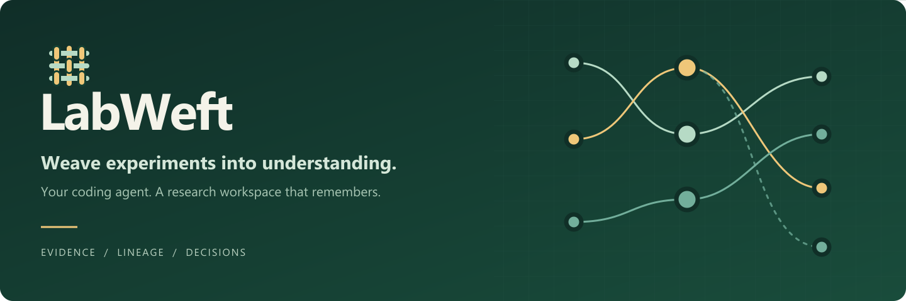
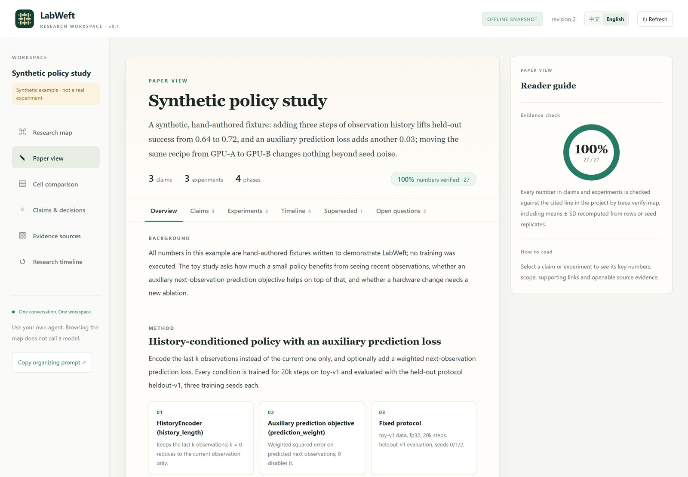
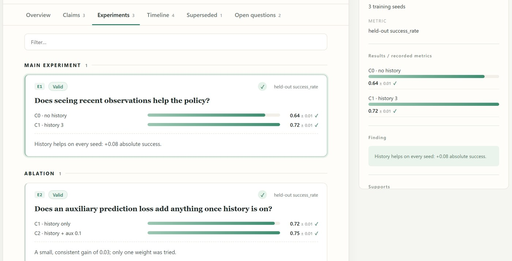
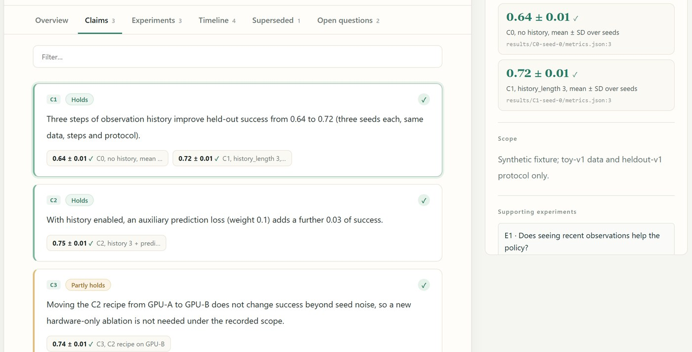
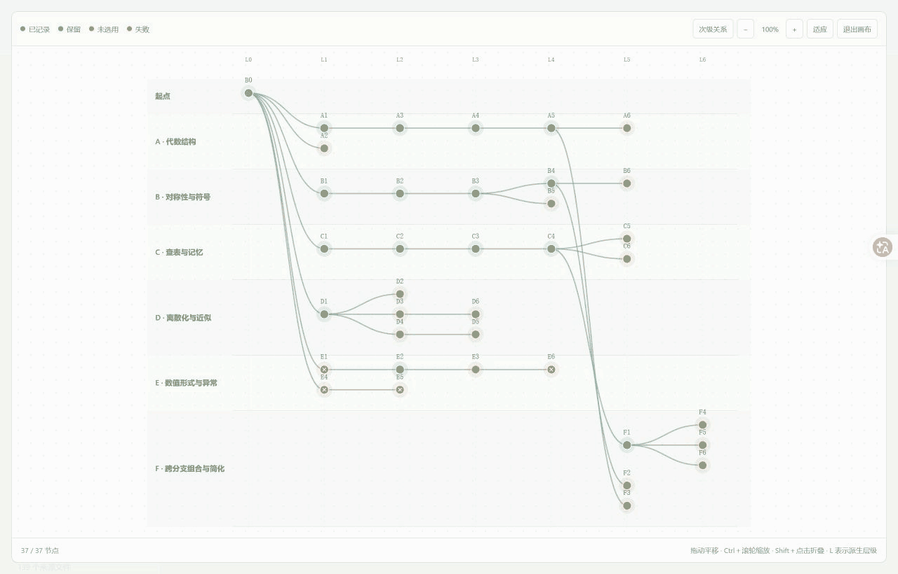

<p align="center">
  
</p>

<p align="center"><strong>English</strong> · <a href="README.zh-CN.md">简体中文</a></p>

<p align="center">
  
  
  
  
  
</p>

<h3 align="center">Read a messy research project like a paper.</h3>

<p align="center">LabWeft lets any coding agent turn months of scattered runs, logs and reports into an evidence-linked map:<br>the questions that were asked, the conditions compared, the claims they support, and every number traced to the line it came from.</p>

<p align="center"><a href="#quick-start">Quick start</a> · <a href="#from-folders-to-a-paper-style-map">Paper view</a> · <a href="#how-it-compares">Benchmarks</a> · <a href="docs/ARCHITECTURE.md">Architecture</a> · <a href="CONTRIBUTING.md">Contribute</a></p>

<p align="center"></p>

<table>
<tr>
<td width="25%" valign="top"><b>No prompt engineering</b><br><sub>The investigation playbook ships with the tool. Ask your agent to "organize this project"; it knows what to read and how to check it.</sub></td>
<td width="25%" valign="top"><b>Organized by research, not folders</b><br><sub>Experiment type → question → compared conditions → claims, merged across copies, archives and summary tables.</sub></td>
<td width="25%" valign="top"><b>Every number verified</b><br><sub>Each value is checked against its cited line, including means ± SD recomputed over seed replicates.</sub></td>
<td width="25%" valign="top"><b>Large, remote, read-only</b><br><sub>A stdlib probe indexes 600k-file trees next to the data over SSH. Your folders are never modified.</sub></td>
</tr>
</table>

<table>
<tr>
<td width="50%"><p align="center"><sub>Experiments as research questions, results as verified bars</sub></p></td>
<td width="50%"><p align="center"><sub>Claims with key numbers, scope and openable sources</sub></p></td>
</tr>
</table>

## See a research tree



The bundled teaching example contains **37 preset candidates, 49 saved CPU evaluations, and six research directions**. Explore the lineage, inspect failed attempts, and trace results to their inputs. Opening this example replays saved synthetic results: it makes **zero new model calls or experiment evaluations**. [Example guide](docs/RESEARCH_TREE_DEMO.md).

## A workspace for the whole research story

| View | What you can explore |
|---|---|
| Research map | A semantic outline and an interactive research tree, with expandable branches and focused details. |
| Experiment lineage | Recorded parent versions, secondary references, and run-level derivations, with explanations of changes and outcomes. |
| Evidence | Source-linked text snapshots and hashes, including failures and missing or changed evidence. |
| Condition comparison | Experimental conditions (Cells) and runs, with scope checks and recorded seed-level statistics. |
| Findings and decisions | Evidence-supported conclusions, their limits, and the research choices they informed. |
| Timeline | Source-dated research events and workspace update history, with module filters. |

The interface opens in **Chinese** and switches to **English**. Multiple independent projects can share a local site with a project selector. Research text uses recorded translations when available and otherwise retains its original language.

## Quick start

From a source checkout, all you need for the examples is Python 3.11+:

```sh
git clone https://github.com/Roboparty/LabWeft.git
cd LabWeft
python labweft.py demo --scenario research-tree ./tree-preview --open --port 0
```

This generates a synthetic workspace and opens its read-only local preview. `--port 0` chooses an available port. Stop the preview with Ctrl+C; the workspace remains on disk. There is no model account, GPU, Node.js, or frontend installation requirement.

For a smaller condition-comparison example:

```sh
python labweft.py demo ./research-demo
python labweft.py serve ./research-demo --open
```

You can also install the local checkout with `python -m pip install .` and use the `labweft` command. LabWeft has not been published to PyPI.

## Connect your project

Keep tool source, project source, and private workspace records in separate directories:

```sh
python bootstrap.py --project /path/to/project --results /path/to/results --workspace /path/to/workspace --agent codex
```

Bootstrap installs one controller Skill and performs an initial factual scan. Source files stay in place; LabWeft stores its records under the workspace's `.research` directory. `--agent claude` and `--agent generic` provide other installation layouts.

Then ask your coding agent to read the project and use the Skill, for example:

> Read the source reports, code, experimental conditions, results, and researcher corrections. Organize the map by research purpose. Explain each version's change, motivation, comparator, and measured outcome. Link conclusions to evidence and preserve their scope. When new experiments arrive, update the existing map and comparisons.

The scanner collects facts; **the host agent supplies research interpretation**. LabWeft does not infer a scientific map from directory names alone. The [bundled Skill protocol](research_harness/skill/research-harness/references/PROTOCOL.md) specifies how to record that interpretation. Fresh-chat automatic Skill discovery and every client/platform combination have not yet been certified.

## Reverse-engineer a large or remote project (trace)

Reading a research folder is reverse engineering: the tree records where files were saved, not what was studied. Inspired by [REA](https://github.com/morluto/rea), `trace` runs a read-only probe next to the data (stdlib only, Python 3.8+, over SSH on the host that mounts your NAS) and gives the agent coverage-aware, three-valued (found / not_found / unknown) investigation tools:

```sh
python labweft.py trace collect ./ws --source PROJ --root /mnt/nas/PROJ --host my-server --remote-dir /data/scratch
python labweft.py trace outline ./ws --source PROJ --format text      # experiments grouped by what was varied x measured, across folders
python labweft.py trace reconcile ./ws --source PROJ --path REPORT.md  # every printed number -> raw value / mean±SD (with SD convention) / same-line difference
python labweft.py trace fetch ./ws --source PROJ --study STUDY --sync  # mirror only the cited files, hash-checked
python labweft.py trace propose ./ws --source PROJ --study STUDY --out draft.json   # draft Cells/Runs with locators filled in
python labweft.py trace obligations ./ws                               # evidence-obligation ledger for claims and runs
python labweft.py mcp ./ws                                             # the same tools as a stdio MCP server
```

Files are classified by content, not name; controlled factors, replicate seeds and one-factor comparisons are recovered from configs, table columns and hyperparameters encoded in run names (e.g. `aw0.1_lw0.1_rh1_s7`); one experiment spread over summary tables, raw results, figure data and legacy copies is one experiment with several evidence locations; text inside tar/zip bundles is parsed. See [the investigation guide](research_harness/skill/research-harness/references/TRACE.md).

## From folders to a paper-style map

Folder names are not research. The agent reads the authors' reports and writes a **semantic map** in the format of [SEMANTIC_MAP.md](research_harness/skill/research-harness/references/SEMANTIC_MAP.md): background and method, claims with their numbers and status, experiments grouped by the question they answer, the timeline, superseded work and open questions. Every item cites `path:line`.

```sh
python labweft.py trace verify-map ./ws --source PROJ --semantic map.json            # every path:line exists, every number is printed there
python labweft.py trace publish-map ./ws --source PROJ --semantic map.json --build-map
python labweft.py export ./ws --include-evidence --output map.html
```

`verify-map` checks each stated number against the cited line at its printed precision, and also accepts values the table there yields: a mean ± SD over seed replicates, whether they are interleaved rows of one table, sibling `run_s7/ run_s8/ run_s9` files, or a train × eval seed grid. On three private multi-month research projects, all 357, 976 and 1,021 cited numbers verified. `publish-map --build-map` turns the map into the workspace: experiment type → research question (with its result table) → one Cell per compared condition, each linked to a hash-pinned snapshot of the line it came from, plus claims linked to the experiments that support them. The paper view (研究语义) and the research tree show it offline.

**Try it** on the bundled synthetic study (hand-authored numbers, 27/27 references verified):

```sh
python labweft.py init ./demo-ws --name "Synthetic policy study"
python labweft.py trace collect ./demo-ws --source policy-study --root examples/policy-study --exclude .research
python labweft.py trace publish-map ./demo-ws --source policy-study --semantic examples/policy-study/semantic_map.json --build-map
python labweft.py export ./demo-ws --include-evidence --output demo.html   # open demo.html in a browser
```

## Audit a whole project

```sh
python labweft.py trace audit ./ws --source PROJ          # leads: copied replicates, truncated runs, seed/checkpoint mismatches, table arithmetic, stale summaries...
python labweft.py trace worklist ./ws --source PROJ       # every report with numbers and the rows nothing in the folder reproduces
```

A whole-project audit of a 613k-file, 11.5 GB index runs in about 11 minutes. Audit findings are leads for the agent to verify, not verdicts.

## How it compares

Same model, same task text, blind grading.

| Benchmark | Reading the folder with shell (Claude Code style) | LabWeft | repomix | gitingest |
|---|---|---|---|---|
| [CORE-Bench](https://github.com/siegelz/core-bench) Easy, 45 tasks, official scoring | 40/45 (88.9%) | **40/45 (88.9%)** | 30/45 (66.7%) | 27/45 (60.0%) |
| Held-out questions on three real projects (up to ~600k files) | baseline | equal or better score, fewer errors, ~70% fewer tool calls, ~1/8 of the time | does not fit in a model context | does not fit in a model context |

Packing tools score close to the others when a capsule fits in the context and fall behind when it does not: 17 of 45 packs exceed 200k tokens. CORE-Bench capsules are small, so LabWeft only ties direct reading there; its advantage grows with project size and disorder. Weakness: when hunting planted defects, a patient shell agent still finds about one to two more than an agent using LabWeft, which mainly saves calls and time. Published reference: CORE-Agent with GPT-4o scores 60% on Easy ([paper](https://arxiv.org/abs/2409.11363)).

## Keep it local, share deliberately

```sh
python labweft.py export /path/to/workspace --output /private/map.html
python labweft.py export-site --output-dir /private/site /workspaces/project-a /workspaces/project-b
```

Offline exports bundle the interface. Add `--include-evidence` to include bounded text snapshots, subject to a 5 MiB limit per project. Review exports before sharing: they can contain private research. Large artifacts and original source files remain at their source locations; a workspace index is not a backup.

## Optional automatic research

The optional [Shinka backend](docs/AUTORESEARCH.md) adds durable search batches, stop/resume handling, and imported candidate evidence and lineage:

```sh
python -m pip install ".[shinka]"
python labweft.py research --help
```

Follow the backend guide before executing a campaign. Live searches require separately authorized model access, compute, and an appropriate execution environment. Their measured scores remain evidence for the specified task; they do not automatically establish a scientific conclusion. Core scanning, viewing, and demos do not require Shinka.

## Read more

| Guide | Contents |
|---|---|
| [Architecture](docs/ARCHITECTURE.md) | Storage model, evidence, semantic patches, and the controller workflow. |
| [Research tree example](docs/RESEARCH_TREE_DEMO.md) | Saved evaluations, replay behavior, and canvas navigation. |
| [Automatic research](docs/AUTORESEARCH.md) | Optional execution lifecycle and its boundaries. |
| [Known limits](docs/LIMITATIONS.md) · [Release gates](docs/RELEASE_GATES.md) | What has been checked and what remains open. |
| [Security](SECURITY.md) · [Contributing](CONTRIBUTING.md) | Privacy boundaries and contribution workflow. |
| [Handoff](docs/HANDOFF.md) · [Changelog](CHANGELOG.md) | Project continuity and recent changes. |

## Development

```sh
python -m unittest discover -s tests -v
node --test tests/test_relations.cjs tests/test_research_tree.cjs
```

Node.js is used for frontend development checks, not by end users. The Python core has no mandatory runtime dependencies. Validation checks record consistency; scientific interpretation still needs evidence review and independent evaluation. The local server is read-only and binds to loopback.

LabWeft is an **alpha open-source project** under the [MIT license](LICENSE). Focused bug reports, clearer evidence contracts, and reproducible examples are welcome. See [acknowledgements](ACKNOWLEDGEMENTS.md) for upstream influences and dependencies.
