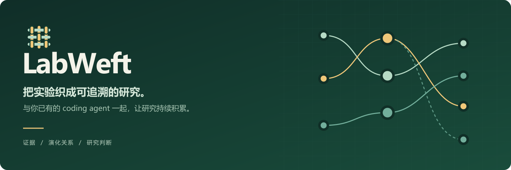

<p align="center">
  
</p>

<p align="center"><a href="README.md">English</a> · <strong>简体中文</strong></p>
<p align="center">Python 3.11+ · MIT · 本地优先 · Alpha 0.1.0</p>

LabWeft 把实验、结果与研究决策整理成可追溯的研究工作空间。你已有的 coding agent 读取并理解项目；轻量的本地 harness 保存记录，让研究内容可以浏览、对照和追踪。

**看清改了什么、为什么改，以及证据到底支持什么。**

<p align="center"><a href="#快速开始">快速开始</a> · <a href="#接入你的项目">接入项目</a> · <a href="docs/AUTORESEARCH.zh-CN.md">自动研究</a> · <a href="docs/ARCHITECTURE.zh-CN.md">架构</a> · <a href="CONTRIBUTING.md">参与贡献</a></p>

## 先看看研究树


内置教学示例包含 **37 个预设候选、49 份已保存的 CPU 评测结果，以及六条研究方向**。可以浏览继承关系、检查失败尝试，并追溯每份结果的输入。打开示例是回放已保存的合成结果，**不会新增模型调用或实验评测**。见[示例指南](docs/RESEARCH_TREE_DEMO.zh-CN.md)。

## 把研究的来龙去脉放在一起

| 视图 | 可以查看什么 |
|---|---|
| 研究地图 | 按研究语义组织的大纲与可交互研究树，可展开分支并就地查看详情。 |
| 实验演化关系 | 已记录的父版本、次级参考与运行派生关系，以及改动原因和实际结果。 |
| 证据 | 关联来源的文本快照与哈希，保留失败记录，并提示证据缺失或变化。 |
| 条件对比 | 实验条件（Cell）和运行记录，核对比较范围，展示已记录的 seed 级统计。 |
| 结论与决策 | 有证据支持的研究结论、适用边界，以及据此作出的研究选择。 |
| 时间线 | 带来源日期的研究事件与工作空间更新记录，支持按模块筛选。 |

界面默认 **中文**，可以切换 **English**。多个独立项目可放在同一个本地网站，通过项目选择器切换。研究正文有已记录的译文时显示译文，否则保留原始语言。

## 快速开始

从源码运行示例只需要 Python 3.11+：

```sh
git clone https://github.com/Roboparty/LabWeft.git
cd LabWeft
python labweft.py demo --scenario research-tree ./tree-preview --open --port 0
```

这会生成合成示例并打开本机只读预览；`--port 0` 自动选择空闲端口。按 Ctrl+C 停止预览后，工作空间仍保存在磁盘上。不需要模型账号、GPU、Node.js 或前端安装。

更小的条件对比示例：

```sh
python labweft.py demo ./research-demo
python labweft.py serve ./research-demo --open
```

也可以用 `python -m pip install .` 安装当前源码，之后使用 `labweft` 命令。LabWeft 尚未发布到 PyPI。

## 接入你的项目

分别存放工具源码、项目源码和私有工作空间记录：

```sh
python bootstrap.py --project /path/to/project --results /path/to/results --workspace /path/to/workspace --agent codex
```

Bootstrap 安装一个控制工作流程的 Skill，并完成初步事实扫描。来源文件留在原处，LabWeft 把记录保存在工作空间的 `.research` 目录。`--agent claude` 与 `--agent generic` 提供其他安装布局。

然后让 coding agent 阅读项目并使用 Skill，例如：

> 阅读项目中的报告、代码、实验条件、结果和研究者修正。按研究目的组织地图；解释每个版本改了什么、为什么改、与谁比较、实际结果如何。结论关联证据并保留适用范围。新增实验后，更新已有地图和对比。

扫描器采集事实，**研究语义由当前 agent 理解后写入**。LabWeft 不会仅靠文件夹名称推断科学地图。[随包 Skill 协议](research_harness/skill/research-harness/references/PROTOCOL.md) 规定了这种理解的记录方式。新聊天自动发现 Skill、所有客户端及平台组合仍未逐一验证。

## 本地使用，按需分享

```sh
python labweft.py export /path/to/workspace --output /private/map.html
python labweft.py export-site --output-dir /private/site /workspaces/project-a /workspaces/project-b
```

离线导出包含完整界面。添加 `--include-evidence` 可附带受大小限制的文本快照，每个项目上限 5 MiB。分享前请检查导出内容，它可能包含私有研究信息。大文件与原始源码仍位于来源位置；工作空间索引不等于备份。

## 可选的自动研究

可选 [Shinka 后端](docs/AUTORESEARCH.zh-CN.md) 提供持久化搜索批次、停止与恢复，以及候选证据和演化关系导入：

```sh
python -m pip install ".[shinka]"
python labweft.py research --help
```

执行前请按后端指南配置任务。真实搜索需要另行授权的模型访问、计算资源和适当的执行环境。分数只说明指定任务中的测量结果，不能自动升级为科学结论。核心扫描、浏览和示例不需要 Shinka。

## 继续了解

| 指南 | 内容 |
|---|---|
| [架构](docs/ARCHITECTURE.zh-CN.md) | 存储模型、证据、语义更新与控制流程。 |
| [研究树示例](docs/RESEARCH_TREE_DEMO.zh-CN.md) | 已保存评测、回放行为与画布操作。 |
| [自动研究](docs/AUTORESEARCH.zh-CN.md) | 可选执行流程及边界。 |
| [已知边界](docs/LIMITATIONS.zh-CN.md) · [发布门槛](docs/RELEASE_GATES.zh-CN.md) | 已核查的内容和待完成事项。 |
| [安全](SECURITY.md) · [参与贡献](CONTRIBUTING.md) | 隐私边界与贡献流程。 |
| [交接记录](docs/HANDOFF.md) · [更新记录](CHANGELOG.md) | 项目衔接和近期变化。 |

## 开发

```sh
python -m unittest discover -s tests -v
node --test tests/test_relations.cjs tests/test_research_tree.cjs
```

Node.js 用于前端开发检查，最终用户无需安装。Python 核心没有强制运行时依赖。验证检查记录一致性；科学解释仍需证据复核与独立评测。本地服务只读，绑定本机回环地址。

LabWeft 是采用 [MIT 许可证](LICENSE) 的 **alpha 开源项目**。欢迎提交具体问题、更清楚的证据约定与可复现示例。上游影响与依赖见[致谢](ACKNOWLEDGEMENTS.md)。
